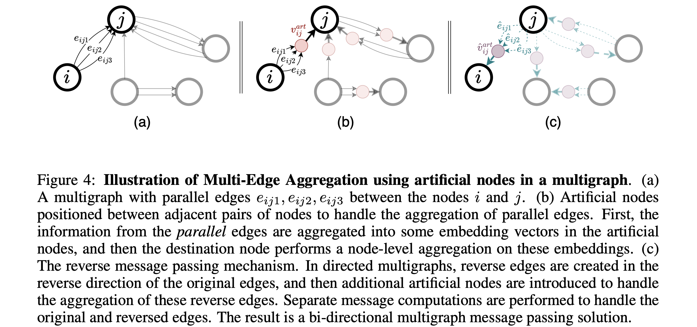

# Mega-GNN

This is the official implemetation of "Multigraph Message Passing with Bi-Directional Multi-Edge Aggregations".

<p align="center">
  
</p>

**Paper**: [arXiv](https://arxiv.org/abs/2412.00241)
## Abstract 
Graph Neural Networks (GNNs) have seen significant advances in recent years, yet their application to multigraphs, where parallel edges exist between the same pair of nodes, remains under-explored. Standard GNNs, designed for simple graphs, compute node representations by combining all connected edges at once, without distinguishing between edges from different neighbors. There are some GNN architectures proposed specifically for multigraphs, yet these architectures perform only node-level aggregation in their message passing layers, which limits their expressive power. Furthermore, these approaches either lack permutation equivariance when a strict total edge ordering is absent, or fail to preserve the topological structure of the multigraph. To address all these shortcomings, we propose MEGA-GNN, a unified framework for message passing on multigraphs that can effectively perform diverse graph learning tasks. Our approach introduces a two-stage aggregation process in the message passing layers: first, parallel edges are aggregated, followed by a node-level aggregation of messages from distinct neighbors. We show that MEGA-GNN is not only permutation equivariant but also universal given a strict total ordering on the edges. Experiments show that MEGA-GNN significantly outperforms state-of-the-art solutions by up to 13\% on Anti-Money Laundering datasets and is on par with their accuracy on real-world phishing classification datasets in terms of minority class F1 score.


## Setup

- Create a new Conda environment, and activate.
```bash
conda env create -f env.yml
conda activate megagnn

```
- Install Pytorch and Pytorch Geometric
```bash
conda install pytorch==2.2.2 torchvision==0.17.2 torchaudio==2.2.2 pytorch-cuda=11.8 -c pytorch -c nvidia
conda install pyg -c pyg
pip install -r requirements.txt
```
- Lastly, install genagg
```bash
cd genagg 
pip install -e .
```


## Data

The data needed for the experiments can be found on [Kaggle](https://www.kaggle.com/datasets/ealtman2019 ibm-transactions-for-anti-money-laundering-aml/data). To use this data with the provided training scripts, you first need to perform a pre-processing step for the downloaded transaction files (e.g. `HI-Small_Trans.csv`):
  ```
  python format_kaggle_files.py /path/to/kaggle-files/HI-Small_Trans.csv
  ```
  - Make sure to change the filepaths in the `data_config.json` file. The `aml_data` path should be changed to wherever you stored the `formatted_transactions.csv` file generated by the pre-processing step.

The data for node classification experiments can be found on [ETH-Kaggle](https://drive.google.com/drive/folders/1d-RATjhyStzSWqU8OLbB74ywa00ztAIf?usp=share_link).


## Run the Code
To use different datasets, change the dataset name and the downstream task, and run the model with the additional parameters provided in utils.py.
- MEGA-GIN
```bash
python main.py --data Small_HI --model gin --emlps --reverse_mp --ego --flatten_edges --edge_agg_type gin --n_epochs 80 --save_model --task edge_class
```
- MEGA-PNA
```bash
python main.py --data Small_HI --model pna --emlps --reverse_mp --ego --flatten_edges --edge_agg_type pna --n_epochs 80 --save_model --task edge_class
```

### IBM AML feature ablations

The IBM AML loader can read either the preprocessed `formatted_transactions.csv`
layout or the original IBM CSV (for example `HI-Small_Trans.csv`). The following
runs isolate each proposed change while keeping the graph model and split fixed:

```bash
# B0: original MEGA-GNN features
python main.py --data Small_HI --model gin --emlps --reverse_mp --ego --flatten_edges --edge_agg_type gin --n_epochs 80 --task edge_class

# B1: corrected continuous transaction representation and train-split normalization
python main.py --data Small_HI --model gin --emlps --reverse_mp --ego --flatten_edges --edge_agg_type gin --n_epochs 80 --task edge_class --aml_semantic_features

# B2: B1 + categorical embeddings for currencies and payment format
python main.py --data Small_HI --model gin --emlps --reverse_mp --ego --flatten_edges --edge_agg_type gin --n_epochs 80 --task edge_class --aml_semantic_features --aml_categorical_features

# B3: B2 + strict historical count features
python main.py --data Small_HI --model gin --emlps --reverse_mp --ego --flatten_edges --edge_agg_type gin --n_epochs 80 --task edge_class --aml_semantic_features --aml_categorical_features --aml_history_features

# B4: B3 + historical time-gap features
python main.py --data Small_HI --model gin --emlps --reverse_mp --ego --flatten_edges --edge_agg_type gin --n_epochs 80 --task edge_class --aml_semantic_features --aml_categorical_features --aml_history_features --aml_history_gaps
```

`--aml_transaction_indicators` separately adds cross-currency, amount-difference,
and self-loop indicators. The full-data audit did not support these as primary
signals, so they are excluded from B1-B4 and should be reported as a separate
ablation.

`--aml_enhanced_features` is a compatibility shortcut for B4 plus the separate
transaction indicators. Categorical or history switches imply `--aml_semantic_features`, so category IDs never enter a
continuous normalized feature vector. Historical features use only transactions
strictly earlier than the current transaction, are normalized with training-split
statistics, and are cached under `cache/aml_history` by default. Evaluation
reports F1, precision, recall, PR-AUC, Average Precision, Recall@100,
Recall@1000, Recall@1%, and grouped metrics by payment format, account-pair
history, 2022-09-09 to 2022-09-10, and the 2022-09-11+ tail. The validation
split selects both the checkpoint and F1 threshold; the test split reuses that
threshold once after training.

### AML multi-edge architecture ablations

The structural variants use the same B2 transaction inputs. Both switches require
AML edge classification, `--flatten_edges`, `--emlps`, and `--edge_agg_type gin`
or `sum`. Conditioned aggregation also requires `--aml_categorical_features`.

`--aml_dual_endpoint_update` adds the receiver state at every layer. Its edge
update uses `[sender, receiver, pair_context, current_edge]`; the S0 update keeps
`[sender, pair_context, current_edge]`.

`--aml_conditioned_edge_agg` keeps the original sum-based account-pair aggregate
for node message passing. It also aggregates transactions by payment format
within each pair, using the same aggregation weights. Each transaction queries
all non-empty payment groups of its pair with learned query/key projections.
Masked softmax selects their context; a feature-wise sigmoid gate interpolates
between this selection and the original pair context for the edge update.
This includes formats different from the query transaction. Single-format pairs
and singleton edges reduce to the original pair context. Missing groups are
masked, and empty relations are supported. Weighted embedding bags avoid storing
an `[edges, payment_formats, hidden]` value tensor. The inputs come from the
sampled graph; this is not a temporally causal sampler or a full-history model.

The optimized implementation skips attention and gating for single-format
pairs, where the selected context is exactly the pair context. It preserves
zero parameter gradients in all-single-format batches to retain Adam momentum
behavior. For mixed-format pairs, masked slots reference each transaction's own
group with zero attention weight, instead of sharing one padding row across all
transactions. Output and gradient equivalence are tested against the previous
version-2 forward. Parameter names and architecture metadata are unchanged;
version-2 S2/S3 checkpoints remain compatible. Floating-point reduction order
can still cause small numerical differences.

| Run | Extra switches on the B2 inputs |
| --- | --- |
| S0 | None |
| S1 | `--aml_dual_endpoint_update` |
| S2 | `--aml_conditioned_edge_agg` |
| S3 | Both |

Keep `gin.params.lr` in `model_settings.json` at `0.0003` for the existing
comparison (the repository default is higher). Use identical epochs, batches,
neighbors, and seeds across S0-S3. Set a separate `model_to_save` directory for
each run in `data_config.json` before launching it.

```bash
export PYTHONPATH="$PWD/genagg:${PYTHONPATH:-}"
common=(--data Small_HI --model gin --task edge_class
        --emlps --reverse_mp --ego --flatten_edges --edge_agg_type gin
        --aml_semantic_features --aml_categorical_features
        --n_epochs 100 --batch_size 1024 --num_neighs 20 20
        --device cuda:3 --seed 42 --save_model --testing)

# Run one variant at a time with its own checkpoint directory.
# S0: B2 architecture baseline
python -u main.py "${common[@]}"

# S1: B2 + dual-endpoint individual-edge update
python -u main.py "${common[@]}" --aml_dual_endpoint_update

# S2: B2 + payment-format-conditioned multi-edge context
python -u main.py "${common[@]}" --aml_conditioned_edge_agg

# S3: B2 + both structural modules
python -u main.py "${common[@]}" --aml_dual_endpoint_update --aml_conditioned_edge_agg
```

Checkpoints record `aml_architecture_config`, including the conditioned context
implementation version. Inference and fine-tuning reject a mismatched variant.
Old B2 checkpoints without this metadata remain supported when both switches
are off. Retrain structural variants saved before this check; the earlier
same-format-only gate is not the current S2/S3 implementation. Select a checkpoint
with `MEGAGNN_CHECKPOINT` and pass the same switches used for training.

Run the small-graph regression suite in the existing PyTorch/PyG environment:

```bash
PYTHONDONTWRITEBYTECODE=1 python tests/test_aml_architecture.py
```

The tests cover CPU/CUDA forward and backward passes, all four ablations,
independently sampled reverse relations, query-dependent group selection,
permutation invariance, pair isolation, singleton/empty inputs, checkpoint
roundtrips, and invalid arguments. CUDA tests skip automatically without a GPU.

To compare the original and optimized S2 aggregation on synthetic graphs using
only an allocated GPU, run (this is not an end-to-end epoch benchmark):

```bash
PYTHONDONTWRITEBYTECODE=1 python tests/benchmark_conditioned_aggregation.py \
  --device cuda:3 --edges 20000 --repeats 7
```

The benchmark reports median forward/backward time and additional peak allocated
memory for several mixed-payment pair fractions. Speedups depend on sampled
graph composition and hardware. An optimized training job can still show 100%
GPU utilization; this implementation does not impose a utilization or power cap.

Example local run (2026-10-22, WSL, PyTorch 2.7.0+cu128, RTX 5060 Laptop,
20,000 synthetic edges, 64 hidden channels, 7 payment formats, 7 timed repeats):

| Mixed-format pair fraction | Original / optimized step (ms) | Original / optimized extra peak (MiB) |
| --- | --- | --- |
| 0% | 270.142 / 43.284 | 74.20 / 28.31 |
| 10% | 237.346 / 60.915 | 76.70 / 38.83 |
| 50% | 212.155 / 68.115 | 81.95 / 63.19 |
| 100% | 183.403 / 88.004 | 87.14 / 86.50 |

These synchronized wall times include kernel launch and host overhead. Timing
varied across local runs; they are not forecasts for an RTX 5090 or the complete
training pipeline. Measure actual epoch times on the allocated training GPU.

### Selected-GPU distributed training

`train_multi_gpu.py` starts a single model with PyTorch DDP on the GPUs selected
by `--gpus`. It supports fresh IBM AML GIN edge-classification runs, including
B0-B4 and S0-S3, with sum node aggregation and gin/sum parallel-edge aggregation.
The existing `main.py` entry remains the single-GPU training/inference entry.

```bash
conda activate mega
cd ~/workspace/stu/zhangyuxiang/MEGA-GNN-main
export PYTHONPATH="$PWD/genagg:${PYTHONPATH:-}"

# One S2 model on GPU 0 and GPU 2, global batch 1024 (512 per GPU).
python -u train_multi_gpu.py --gpus 0 2 \
  --data Small_HI --model gin --task edge_class \
  --emlps --reverse_mp --ego --flatten_edges --edge_agg_type gin \
  --aml_semantic_features --aml_categorical_features --aml_conditioned_edge_agg \
  --batch_size 1024 --num_neighs 20 20 --n_epochs 100 --seed 42 \
  --lr 0.0003 --testing --save_model \
  --checkpoint_dir checkpoints --run_name S2_ddp02_seed42
```

`--gpus 0,2` is also accepted; `--gpus 0 1 2 3` uses four GPUs. Do not pass
`--device` to this launcher. If `CUDA_VISIBLE_DEVICES` is already set by a
scheduler/container, indices refer to that visible list, and the launcher
selects a subset without expanding it. Startup prints the mapping. The default
data path file is `data_config.json`; `--data_config another.json` overrides it.
`--lr` overrides the model setting for this run without editing shared JSON.
For S1 replace the conditioned switch with `--aml_dual_endpoint_update`; for S3
enable both. Use a different `--run_name` for every experiment. Existing run
directories are rejected to prevent checkpoint overwrites.

Only rank zero writes logs and checkpoints. The run directory contains
`training.log`, `run_config.json`, `results.json` after completion, and
`epoch_*.tar` when `--save_model` is enabled. Checkpoints have no `module.` prefix
and can be evaluated using `main.py --inference` and `MEGAGNN_CHECKPOINT` with the
same model/feature switches. Multi-GPU inference and resuming optimizer/epoch
state are not implemented by this launcher.

`--batch_size` is the global batch, not the batch per GPU. Each shuffled global
batch is split without duplicating real training seeds; a rank with no seeds in
the final step uses a dummy forward whose loss and metrics are excluded. Uneven
splits (e.g. 1024 over three GPUs) are allowed. Weighted cross entropy uses the
global sum of class weights, rather than averaging independently normalized
per-rank losses. Validation/test predictions are gathered to rank zero to
compute global F1/AP and select one validation threshold. The best model and
threshold are applied once to the test set after training. As in the existing
pipeline, only seed edges found in the sampled graph are scored; logs report
scored/requested edge counts so sampling coverage remains visible.

Each worker keeps its own CPU graph and sampling state: host RAM requirements
grow with GPU count. The history cache is built by rank zero first to avoid
concurrent cache writes. Model BatchNorm remains local per worker; rank zero's
running statistics are broadcast for evaluation and saved in checkpoints.
One-node training batches use the existing running statistics instead of failing
BatchNorm's minimum-batch-size check.
Neighbor samples and dropout also differ from single-GPU training. Matching the
global batch and learning rate does not imply identical single-/multi-GPU runs;
compare ablations using the same GPU count and protocol. DDP does not impose a
GPU utilization cap and does not guarantee a speedup on shared GPUs.

Validation commands in the project environment:

```bash
PYTHONDONTWRITEBYTECODE=1 python tests/test_distributed_training.py
```

The suite checks GPU mapping, global batches and dummy tails, two-process Gloo
training on CPU, weighted-gradient equivalence, empty evaluation shards,
checkpoint loading, and a one-GPU NCCL/torchrun run on synthetic AML data.
One-GPU CUDA tests skip automatically when CUDA/NCCL is unavailable. A successful
local suite does not substitute for an actual multi-GPU NCCL test on the server.

Local verification on 2026-10-22 passed the two-rank CPU/Gloo tests and the
one-GPU NCCL/launcher tests. The local WSL NCCL default setup timed out; the GPU
tests passed with `NCCL_CUMEM_HOST_ENABLE=0`, `NCCL_CUMEM_ENABLE=0`,
`NCCL_P2P_DISABLE=1`, and `NCCL_IB_DISABLE=1` explicitly set for testing. The
launcher does not force these transport settings on a Linux server. Start with
`--n_epochs 1 --run_name S2_ddp02_check` on the selected server GPUs, then use a
new run name for the full experiment after confirming startup and saved results.

Preprocessing barriers, graph/config object broadcasts, and prediction gathering
now use a separate CPU/Gloo group; gradient and model-tensor synchronization
still use NCCL. This avoids placing a GPU wait kernel in a preprocessing barrier
while other ranks load the dataset. NCCL initialization explicitly binds each
worker to its local CUDA device. Each rank prints its PID/device and startup
phase so failures before `Epoch 0` can be distinguished from model execution.

If startup reports CUDA illegal memory access, that run has failed; the reported
GPU utilization alone does not identify the cause. First test communication in
new processes without loading AML data or creating a checkpoint directory:

```bash
python -u train_multi_gpu.py --gpus 0 1 2 --nccl_compat \
  --data Small_HI --model gin --check_distributed
```

Every rank must print `DISTRIBUTED CHECK PASSED` and the command must exit
successfully. The optional `--nccl_compat` applies the four transport environment
settings above only to the launched job; it is a diagnostic fallback, not a
guaranteed fix or a server-wide change. If the check passes, use the same GPUs
and compatibility flag for a one-epoch run with a new run name. If it fails,
investigate the CUDA/NCCL/driver/topology environment before loading the full
dataset. Passing the communication check does not validate all GNN kernels.

If the linear communication check passes but the real run fails before `Epoch 0`,
test the selected GNN's initialization and three optimizer steps without loading
the AML CSV:

```bash
CUDA_LAUNCH_BLOCKING=1 python -u train_multi_gpu.py --gpus 0 1 2 --nccl_compat \
  --data Small_HI --model gin --task edge_class \
  --emlps --reverse_mp --ego --flatten_edges --edge_agg_type gin \
  --aml_semantic_features --aml_categorical_features --aml_conditioned_edge_agg \
  --lr 0.0003 --seed 42 --check_model_distributed
```

This uses the configured hidden width/layer count and selected S0-S3 modules,
on a synthetic graph with 16 nodes, 64 edges, and category cardinalities
`[16, 16, 7]`. It does not reproduce the size or exact category counts of the
real dataset and does not support port/time-delta features. Every rank should
print `MODEL DDP CHECK PASSED`. Startup also verifies model state layout and
trainable parameter names across ranks before CUDA transfer, and prints stages
for CPU model construction, CUDA transfer, and DDP construction. The diagnostic
prints forward/backward/update stages and synchronizes CUDA at each boundary.
Use the last completed stage and full error output to narrow the cause rather
than attributing every NCCL watchdog report to the communication library.

## Citation
If you use our work in your research, please cite our paper:

    @misc{bilgi2024multigraphmessagepassingbidirectional,
          title={Multigraph Message Passing with Bi-Directional Multi-Edge Aggregations}, 
          author={H. Çağrı Bilgi and Lydia Y. Chen and Kubilay Atasu},
          year={2024},
          eprint={2412.00241},
          archivePrefix={arXiv},
          primaryClass={cs.LG},
          url={https://arxiv.org/abs/2412.00241}, 
    }

### Acknowledgements

We used the codebase of [Multi-GNN](https://github.com/IBM/Multi-GNN) and [GenAgg](https://github.com/Acciorocketships/generalised-aggregation) and thank their authors for their excellent work.
