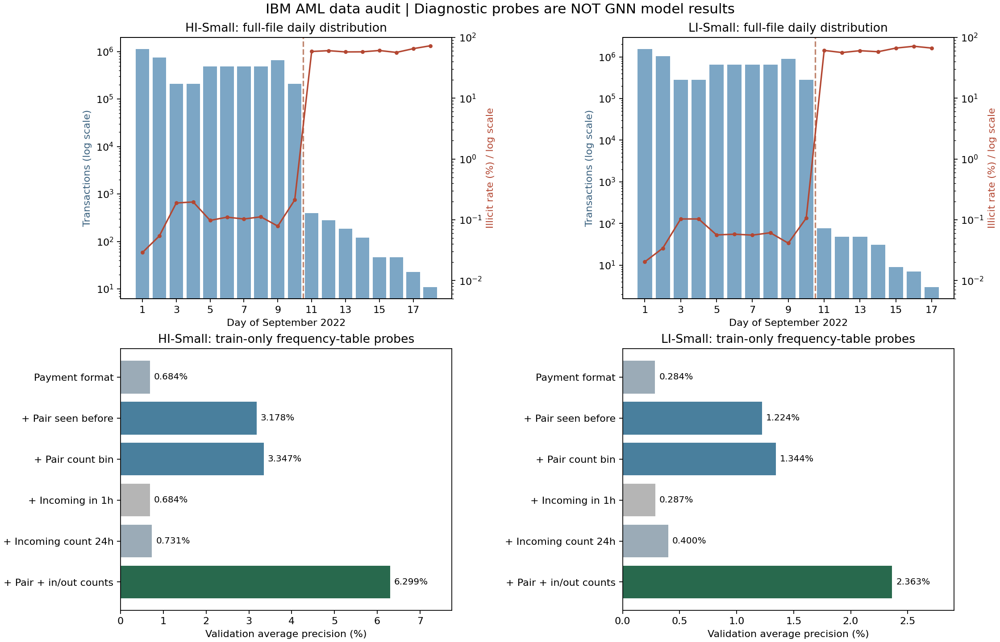

# IBM AML 两份实际数据的诊断与改进方案

分析日期：2026-09-29。对工作区的两个原始 CSV 全量计算，共 12,002,394 笔交易。

结论：优先验证“支付方式条件化的关系历史特征＋MEGA 多重边主干”。降低跨币种金额差异、快速入账后转出、纯长序列 Transformer 的优先级。下面区分数据事实、诊断预测实验与待验证的模型设计。

## 1. 数据范围和方法

| 指标 | HI-Small | LI-Small |
| --- | --- | --- |
| 交易数 | 5,078,345 | 6,924,049 |
| 洗钱交易数 | 5,177 | 3,565 |
| 洗钱比例 | 0.1019% | 0.0515% |
| 账户数（银行＋账号） | 515,088 | 705,907 |
| 最早时间 | 2022/09/01 00:00 | 2022/09/01 00:00 |
| 最晚时间 | 2022/09/18 16:18 | 2022/09/17 15:28 |
| 币种数 | 15 | 15 |
| 支付方式数 | 7 | 7 |

- 原始 CSV 没有按时间排序，不能直接按行顺序构造历史。
- 同一银行＋账号定义一个节点。两份文件均无缺失字段，本次检查未发现原格式器的银行账号字符串拼接碰撞。
- 历史定义严格为 `t_history < t_current`；同一分钟交易互相不可见。不是排除当前行后允许同分钟其他行。
- 付款方入账历史排除自转账；出账活动也排除自转账。账户对历史按原始有向账户对计算。
- 所有历史特征仅使用时间、账户和交易存在性，不读取标签。标签只用于训练频率表和诊断分组。
- 全量账户对是否重复、是否混合标签仅为事后诊断，不是可输入实时模型的特征。
- 复现当前 `get_data` 的按天近似 60/20/20 划分，两个文件均得到 9 月 1–6 日训练、7–8 日验证、9 日起测试。
- 检查了完整文件的标签分布；特征证据主要来自训练集，频率预测器仅在验证集评估，没有训练 GNN，也没有用测试集调阈值。

| 数据集 | 划分 | 交易数 | 洗钱数 | 洗钱比例 |
| --- | --- | --- | --- | --- |
| HI-Small | train | 3,248,921 | 2,530 | 0.0779% |
| HI-Small | validation | 965,524 | 1,036 | 0.1073% |
| HI-Small | test | 863,900 | 1,611 | 0.1865% |
| LI-Small | train | 4,432,934 | 1,993 | 0.0450% |
| LI-Small | validation | 1,316,442 | 770 | 0.0585% |
| LI-Small | test | 1,174,673 | 802 | 0.0683% |

## 2. 当前证据支持与不支持什么

### 2.1 跨币种和金额差异不是当前优先方向

两份文件中所有正样本的付款/收款币种一致，付款/收款金额相等。因此，之前提出用金额差异或跨币种路径作为主要创新，没有得到这两份数据支持。

保留正确的类别编码仍有必要；补入缺失字段可以做低成本消融，但不应预设其收益。也不能把“跨币种＝正常”写成硬规则，这只是当前文件的经验分布。

### 2.2 首次观察到的账户关系，比单纯短时间入账更有依据

| 训练集统计 | HI-Small | LI-Small |
| --- | --- | --- |
| 正常交易：此前同方向账户对有交易 | 70.7130% | 70.6358% |
| 洗钱交易：此前同方向账户对有交易 | 19.1700% | 26.6433% |
| 正常交易：付款方此前 1 小时有外部入账 | 6.7298% | 7.0031% |
| 洗钱交易：付款方此前 1 小时有外部入账 | 6.7984% | 10.2860% |
| 正常交易：付款方此前 24 小时有外部入账 | 49.5579% | 49.5197% |
| 洗钱交易：付款方此前 24 小时有外部入账 | 45.8498% | 40.8931% |

以上是训练集交易级比例。首次观察到只表示文件历史中未出现，不代表真实账户此前从未往来。1 小时窗口在 HI 中正负样本几乎相同，在 LI 中差异也不构成跨数据集稳定的强证据。

### 2.3 关系历史必须结合支付方式解释

下面均为训练集各组内洗钱率：

| 支付方式 | HI 首次观察到账户对 | HI 已有历史 | LI 首次观察到账户对 | LI 已有历史 |
| --- | --- | --- | --- | --- |
| ACH | 1.5594% | 0.0638% | 0.8084% | 0.0289% |
| Bitcoin | 0.0759% | 0.0220% | 0.0901% | 0.0160% |
| Cash | 0.0296% | 0.0202% | 0.0170% | 0.0208% |
| Cheque | 0.0201% | 0.0179% | 0.0203% | 0.0166% |
| Credit Card | 0.0098% | 0.0172% | 0.0060% | 0.0175% |

ACH 中首次观察到的关系风险更高；Cash、Credit Card 等类别却不完全遵循相同方向。因此，不应硬编码“新关系一定更可疑”。建议把支付方式作为条件，学习历史次数、收付活动与风险的交互。

这里只观察到相关性；新关系可能部分反映生成器的模式注入方式，尚不能推断真实银行数据有相同规律。

### 2.4 简单预测实验验证了部分信息的增量价值

训练阶段按上表输入组合统计正例率，并以支付方式正例率作平滑先验（固定 1000 个伪观测）。历史次数分箱为 0、1–2、3–8、9–32、33+。验证阶段使用训练频率表打分，未见组合退回支付方式先验。AP 按相同分数合并后计算，避免排序并列造成虚假提升。

| 诊断预测器输入 | HI 验证集 AP | LI 验证集 AP |
| --- | --- | --- |
| 仅支付方式 | 0.006842 | 0.002838 |
| 支付方式＋是否有账户对历史 | 0.031778 | 0.012237 |
| 支付方式＋账户对历史次数分箱 | 0.033469 | 0.013437 |
| 支付方式＋此前 1 小时是否入账 | 0.006843 | 0.002867 |
| 支付方式＋此前 24 小时入账次数分箱 | 0.007310 | 0.004002 |
| 支付方式＋账户对次数＋24 小时收付次数分箱 | 0.062988 | 0.023626 |

这些是低容量频率表的验证集 AP，不是 MEGA-GNN 的 AP，也不是新 GNN 对原 GNN 的提升。绝对 AP 仍低。结果只表明支付方式、账户对历史、收付活动的组合含有可用信息；GNN 是否已隐式学到这些信息，仍需模型消融。

## 3. 必须单独报告的时间尾部

两个文件大部分交易都在 2022-09-01 至 2022-09-10，但文件实际持续到 17/18 日。9 月 11 日起交易量骤降，正例比例骤升。

| 数据集 | 9 月 11 日起交易数 | 其中洗钱数 | 尾部洗钱比例 | 占完整测试集洗钱数 |
| --- | --- | --- | --- | --- |
| HI-Small | 1,108 | 655 | 59.1155% | 40.6580% |
| LI-Small | 223 | 134 | 60.0897% | 16.7082% |

建议保留完整测试集以便比较原基线，额外分别报告 9 月 9–10 日和 9 月 11 日起尾部的指标。不能因查看标签后发现尾部不同，就静默删除这部分再与原论文结果比较。

模型第一版不直接输入从数据集起点算起的绝对时间；原始时间戳保留给历史构造、采样和分组评估。绝对时间是否保留需对所有基线做同协议消融。该分布只能说明有利用日期捷径的风险，本次未证明已训练的原模型依赖它。

## 4. 对现有代码的具体改法

### 4.1 先实现可消融的特征增强版本

新增 `history_features.py`，在完整时间流上预计算以下无标签特征，再按原始 EdgeID 附着到每笔交易：

```text
pair_seen_before                 此前是否出现相同有向账户对
log1p(pair_count_before)          相同有向账户对累计次数
log1p(pair_last_gap_minutes)      距上次账户对交易的间隔
pair_history_missing             无历史掩码
log1p(sender_in_count_24h)        付款方过去 24h 外部入账次数
log1p(sender_out_count_24h)       付款方过去 24h 外部出账次数
log1p(sender_last_in_gap)         距付款方上次外部入账的间隔
sender_in_history_missing        无入账掩码
```

其中计数特征已有验证集诊断证据；时间间隔特征仅已有覆盖/分布检查，仍应独立消融。24h 是本次诊断使用的候选窗口，不是已经证明的最优窗口。先实现已有证据的组合，不同时增加多组窗口。

`data_loading.py`：类别字段使用整型张量，连续字段单独标准化；只在训练集拟合标准化统计量。保留独立原始时间戳。不要在随机采样后的局部 batch 内重新计算全局账户对历史次数。

`models.py`：增加类别 Embedding 和历史 MLP。第一版仅把新表示接入现有边编码/边分类器，保持原 GNN 消息传递一致，用以确定新增信息的净收益。

```python
semantic = concat(currency_embedding, payment_format_embedding, amount_features)
history = history_mlp(history_features)
logits = classifier(concat(h_src, h_dst, edge_state, semantic, history))
```

此处为接口示意，不是已修改并训练的模型代码。不同类别 ID 不能再作为连续数值整体 z-score。

### 4.2 特征有效后，再做支付方式条件化的结构改进

保留 MEGA 原有账户对聚合，构造一个以当前交易为中心的更新：

```python
pair_context = mega_pair_aggregation(...)
individual = individual_mlp(concat(edge_state, h_src, h_dst, history))
gate = sigmoid(gate_mlp(concat(payment_embedding, history)))
updated_edge = edge_state + gate * pair_context + (1 - gate) * individual
```

维度通过各分支投影统一。支付方式条件可以首先只放在门控/分类器，不必立刻复制七套完整 GNN。

目的：让模型根据支付方式和既有关系，选择账户对汇总信息与当前单笔交易/两端状态的相对权重。它是根据数据证据提出的可检验机制，不是已证明的最优结构或论文独创方法。

原 MEGA 已保留逐边状态并在分类器使用两端节点，不能声称它完全丢失单笔交易；原多重边分支的边更新未显式拼接 `x[dst]`，可单独做双端点边更新对照。全量诊断发现存在同一账户对正负标签混合的交易，更需要用实验检验条件化更新而不是把账户对整体打标签。

### 4.3 数据、训练、评估必须同步修改

| 文件 | 修改内容 |
| --- | --- |
| `format_kaggle_files.py` | 唯一 EdgeID 与账户映射保持一致；避免两个原始文件写入同一个 formatted_transactions.csv；分别输出到 Small_HI / Small_LI |
| 新增 `history_features.py` | 时间排序、同分钟分组先查询后更新、无标签历史计算与缓存 |
| `data_loading.py` | 类别/连续特征分离；训练统计量复用；以 EdgeID 对齐历史特征；时间仅作为独立元数据或消融输入 |
| `models.py` | 先新增特征编码；再单独启用支付方式条件门控与双端点更新 |
| `train_util.py` | 采样时同步索引新增特征；概率而非单列 raw logit 计算 AP；增加分组评估 |
| `training.py` | 验证集选择 checkpoint/阈值；测试集在模型选定后评估；报告每种支付方式的召回 |
| `util.py` | 独立开关，使各改进可以逐项关闭 |

当前 `compute_binary_metrics` 把 `preds[:, 1]` 当概率，但分类模型输出两类 logits。二分类排序应使用 `softmax(logits)[:, 1]` 或等价 logit 差；同时明确区分梯形 PR-AUC 与 AP。原函数名 `auc` 的计算不是 ROC-AUC。

## 5. 建议实验顺序和接受标准

1. B0：复现原始 MEGA，保留原配置和评估结果。
2. B1：统一修正编码/归一化/概率指标，形成所有后续实验共用基线。
3. B2：B1 加账户对历史＋付款方 24h 收付活动，保持 GNN 结构一致。
4. B3：B2 加支付方式条件门控；与直接拼接历史特征、参数量接近的 MLP 对照。
5. B4：双端点边更新作为独立消融，不与门控同时新增后只报告一个结果。
6. 报告完整测试集、9 月 9–10 日、尾部、首次关系/既有关系、各支付方式的 F1/AP/Recall@K；阈值只能由验证集确定。
7. 检查两个数据集、至少三个随机种子下是否都有稳定收益，并报告参数量、运行时间与显存。

如果 B2 无收益，说明原 GNN 可能已经捕获这些信号，应停止继续围绕同一信号增加门控；如果 B3 不优于 B2，就保留更简单的特征增强版本。不能把频率表 AP 的提升比例宣称为 GNN 的提升比例。

现有训练图是静态时间快照；历史特征严格使用过去，不会自动让整个 GNN 成为逐笔实时模型。若另做实时协议，两个方向的结构采样也必须在查询时刻截断，并让全部基线使用同一协议。

## 6. 文件与复现

- `analysis/audit_aml.py`：全量审计，包含严格时间索引的小型正确性检查和总量校验。
- `analysis/probe_aml.py`：只用训练集拟合的频率诊断预测器，验证集 AP，包含 AP 并列分数检查。
- `analysis/build_report.py`：生成本报告与图片。
- `analysis/results/*_audit.json`：完整统计；`*_probes.json`：诊断预测结果。
- `analysis/results/*_diagnostic_features.parquet`：不含原始账户标识的诊断特征缓存。
- 依赖：Python、NumPy、Polars；绘图额外需要 Matplotlib。本次未安装新依赖。
- 当前 Python 环境缺少 PyTorch，仓库 C++ 扩展为 Linux `.so`，本次没有启动 GNN 训练，也没有修改模型训练代码。

```powershell
python analysis/audit_aml.py HI-Small_Trans.csv LI-Small_Trans.csv
python analysis/probe_aml.py
python analysis/build_report.py
```


